# Executive Business Operations & Administrative Support Hub

A portfolio project demonstrating how senior executive support can be structured around **decision readiness, disciplined follow-through, stakeholder coordination, travel management, procurement control, recurring administrative routines, and AI-assisted workflows**.

The project simulates an executive operations environment in which meetings, priorities, approvals, travel, and follow-up are connected through a centralized operating system rather than managed as isolated administrative tasks.

> **Portfolio note:** All names, organizations, meetings, confirmation numbers, phone numbers, financial values, and business scenarios in this project are fictional and were created solely for demonstration purposes.

---

## Executive Dashboard

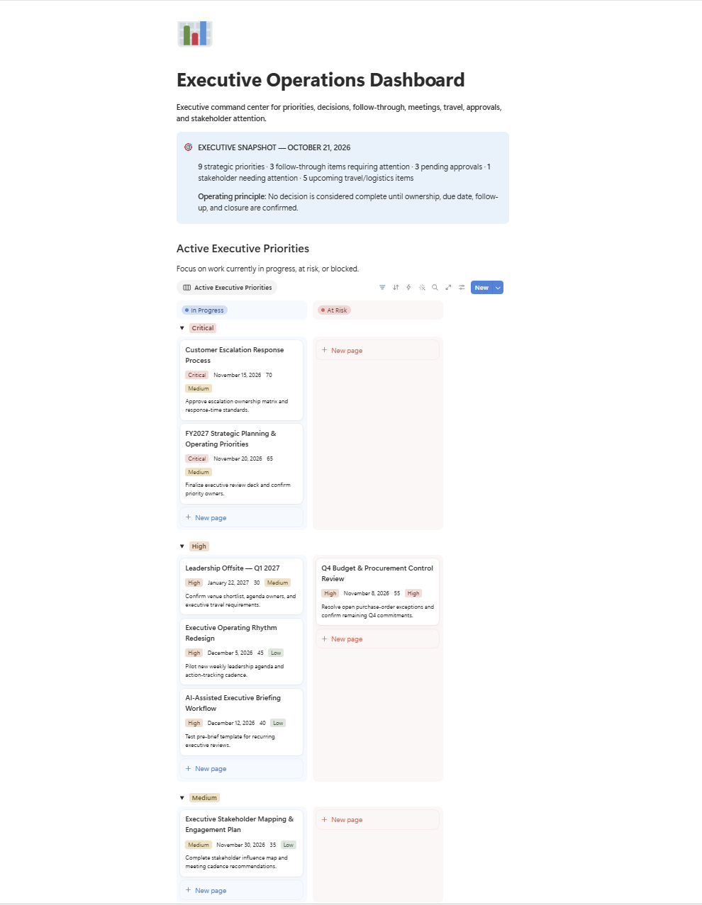

The dashboard is designed as an executive command center that surfaces what requires attention rather than forcing a leader to navigate multiple databases.

It brings together:

- Active executive priorities
- Decisions requiring attention
- Follow-up due and at-risk actions
- Upcoming meetings and pre-brief readiness
- Pending approvals and expense exceptions
- Upcoming executive travel
- Stakeholder follow-up
- Recurring administrative routines

### Dashboard — Decisions, Meetings & Approvals

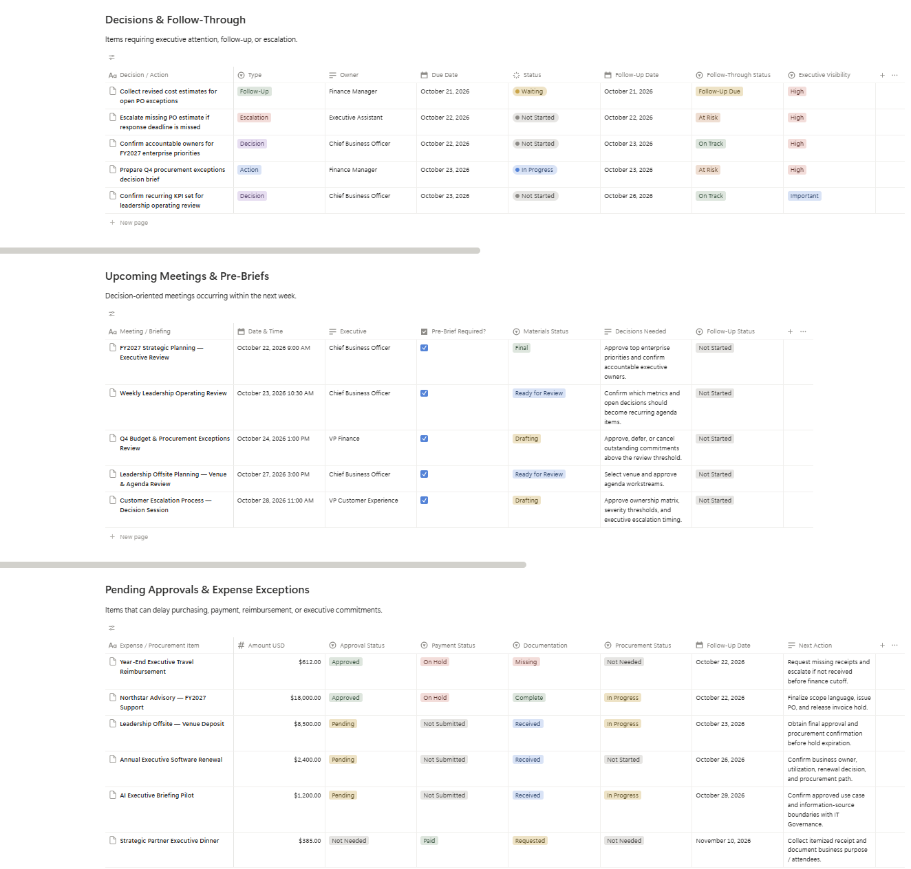

### Dashboard — Travel, Stakeholders & Admin Rhythm

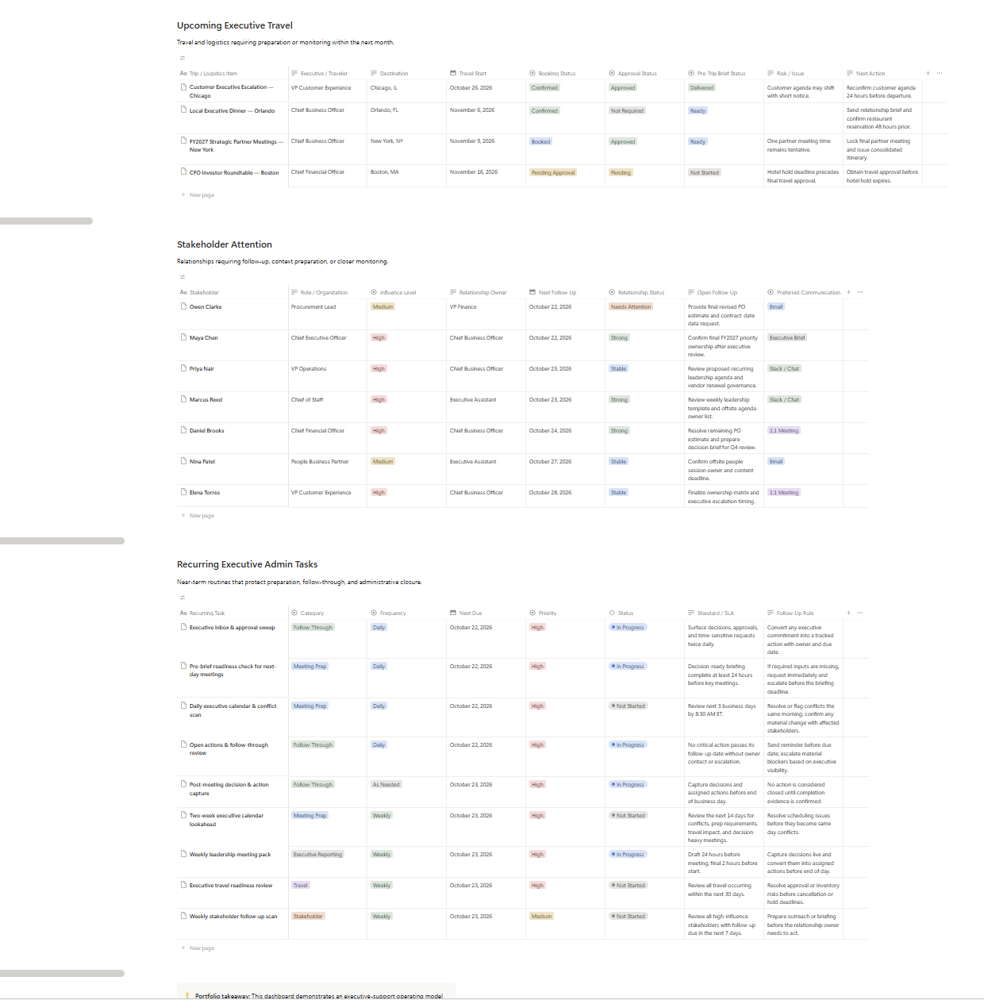

---

## Executive Snapshot

The portfolio system contains:

- **9** strategic executive priorities
- **10** executive meetings and briefing records
- **14** decisions, actions, follow-ups, and escalations
- **10** stakeholder relationship records
- **5** executive travel and logistics scenarios
- **10** expense and procurement records
- **12** recurring executive support routines
- **1** end-to-end Executive Travel Brief case study across Notion, Google Calendar, Slack, and PDF

---

## Business Challenge

Senior executives operate across competing priorities, meetings, stakeholders, travel, approvals, and fast-moving decisions. Without a structured operating system, important actions can disappear between meetings, follow-up becomes reactive, and leaders spend too much time searching for context.

This project was designed to demonstrate an executive-support model that converts executive activity into clear ownership and closure.

### Core Operating Model

**Executive Priority → Meeting → Decision → Action → Owner → Due Date → Follow-Up → Completion**

A central principle of the project is:

> **No decision is considered complete until ownership, due date, follow-up, and closure are confirmed.**

---

## Solution Architecture

The system was built in Notion with connected operational databases for:

  
  &nbsp; ➜ &nbsp;
  
  &nbsp; ➜ &nbsp;
  
  &nbsp; ➜ &nbsp;
  
  &nbsp; ➜ &nbsp;
  
  &nbsp; ➜ &nbsp;
  

1. **Executive Priorities** — strategic initiatives, owners, milestones, risk, and progress
2. **Meetings & Briefings** — meeting objectives, executive context, pre-brief status, and decisions needed
3. **Decision & Action Tracker** — decisions, actions, owners, due dates, blockers, follow-up, escalation, and closure evidence
4. **Stakeholders** — influence, engagement cadence, relationship ownership, context, and next follow-up
5. **Travel & Executive Logistics** — itinerary readiness, traveler preferences, approvals, logistics, risk, and next actions
6. **Executive Expenses & Procurement** — approval status, documentation, procurement, payment, exceptions, and follow-up
7. **Recurring Executive Tasks** — operating cadence, SLAs, checklists, timing, and follow-through rules

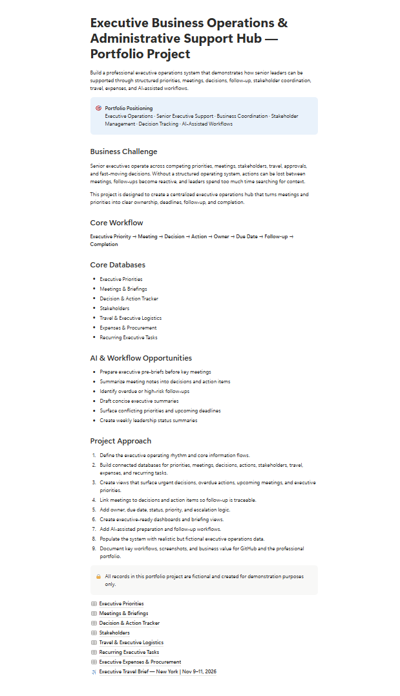

---

## 1. Meetings & Executive Briefing

The meeting system is designed to demonstrate that executive support goes beyond calendar scheduling. Each meeting can include the objective, stakeholders, related priority, pre-brief requirement, materials status, key context, and decisions needed.

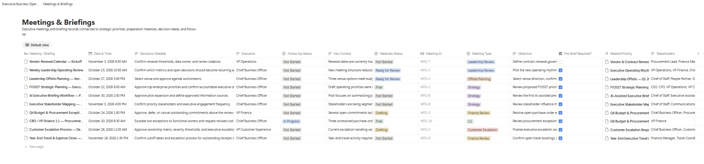

### Executive-support behaviors demonstrated

- Pre-brief preparation before decision-heavy meetings
- Consolidation of context and unresolved issues
- Clear identification of decisions required from the executive
- Materials-readiness tracking
- Post-meeting follow-up status

---

## 2. Decision & Action Follow-Through

The Decision & Action Tracker is the core of the project because it demonstrates **follow-through**, not just task tracking.

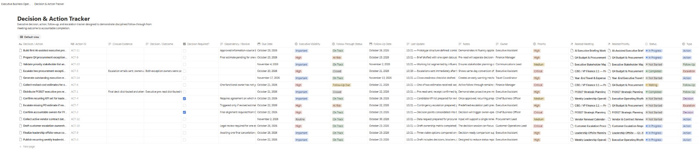

Each item can capture:

- Decision vs. action vs. follow-up vs. escalation
- Owner and due date
- Decision requirement
- Dependency or blocker
- Follow-up date
- Follow-through status
- Executive visibility
- Last update
- Closure evidence

This allows an executive support professional to answer not only **“What was decided?”** but also **“Who owns it, when is it due, what is blocking it, and has the loop actually been closed?”**

---

## 3. Stakeholder Management

The stakeholder database treats relationship management as an active operating process rather than a static contact list.

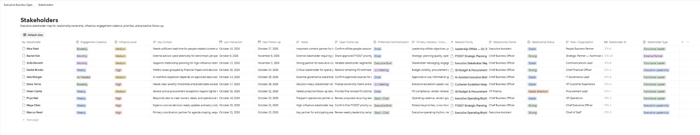

It tracks:

- Influence level
- Relationship owner
- Engagement cadence
- Last interaction
- Next follow-up
- Relationship status
- Preferred communication method
- Key context
- Open follow-up

This structure supports proactive preparation before the executive needs to engage.

---

## 4. Executive Expenses & Procurement

The expense and procurement tracker demonstrates the administrative control required behind executive decisions and commitments.

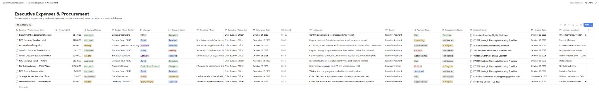

Scenarios include:

- Airfare and hotel reconciliation
- Ground transportation
- Executive meals
- Offsite venue deposits
- Professional-services purchasing
- Software subscriptions
- Missing receipts and reimbursements
- Procurement and PO dependencies

The workflow emphasizes:

**Request → Approval → Documentation → Procurement → Payment → Exception → Follow-Up → Closure**

---

## 5. Recurring Executive Administration

Executive support requires a reliable operating rhythm, not only one-time tasks.

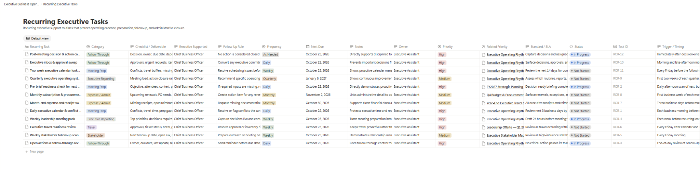

Examples include:

- Daily executive calendar and conflict scan
- Executive inbox and approval sweep
- Pre-brief readiness check
- Open actions and follow-through review
- Two-week calendar lookahead
- Weekly leadership meeting pack
- Weekly stakeholder follow-up scan
- Executive travel readiness review
- Month-end expense and receipt sweep
- Subscription and procurement review
- Post-meeting decision and action capture
- Quarterly executive operating-system review

---

# Executive Travel Management Case Study

Travel management was developed as a separate mini-case because executive travel requires two distinct layers:

### Administrative / Control Layer

Approvals, bookings, hotel, transportation, policy, documentation, risks, and expense follow-up are managed internally.

### Executive-Facing Layer

The traveler receives a concise, mobile-friendly travel experience that includes the live itinerary, meeting context, calendar execution, change notifications, and an offline backup.

---

## Live Executive Travel Brief — Notion

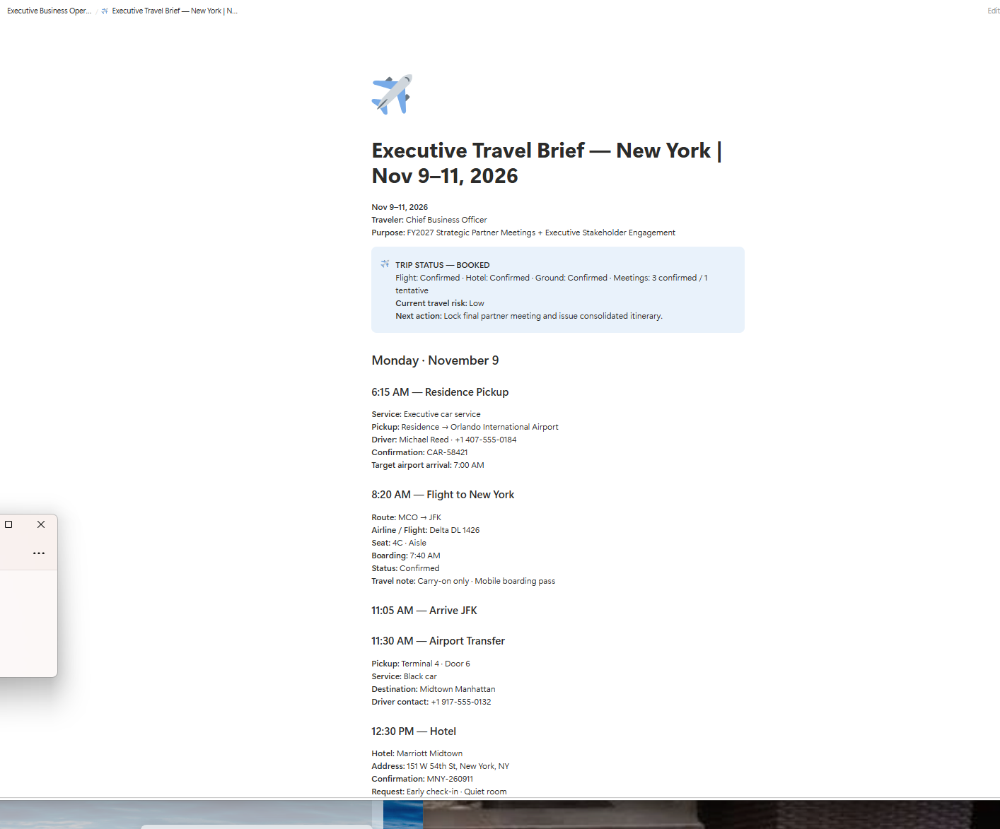

The live travel brief is organized chronologically rather than as disconnected reservation tables. It includes flights, ground transportation, hotel, meetings, decision context, traveler preferences, key contacts, and contingencies.

### Mobile View

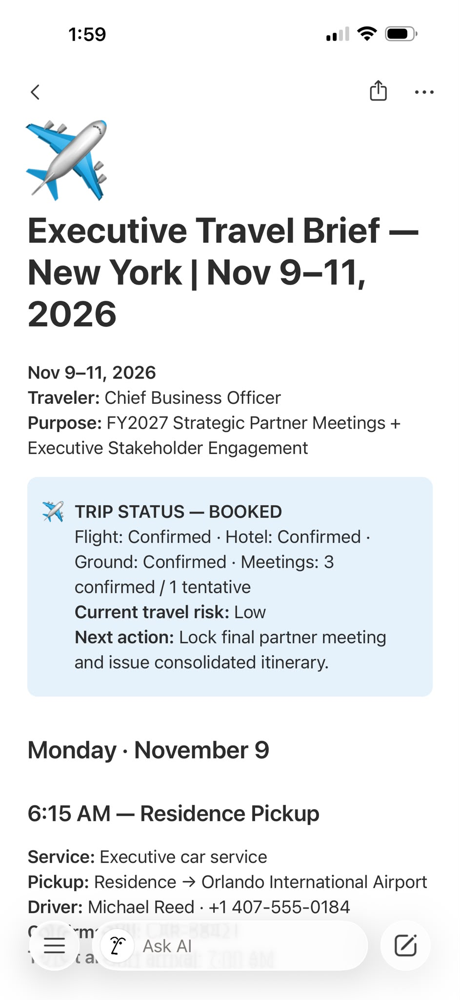

The mobile format is designed so an executive can quickly identify **what happens next** without navigating a spreadsheet or multiple confirmation emails.

---

## Slack — Real-Time Travel Communication

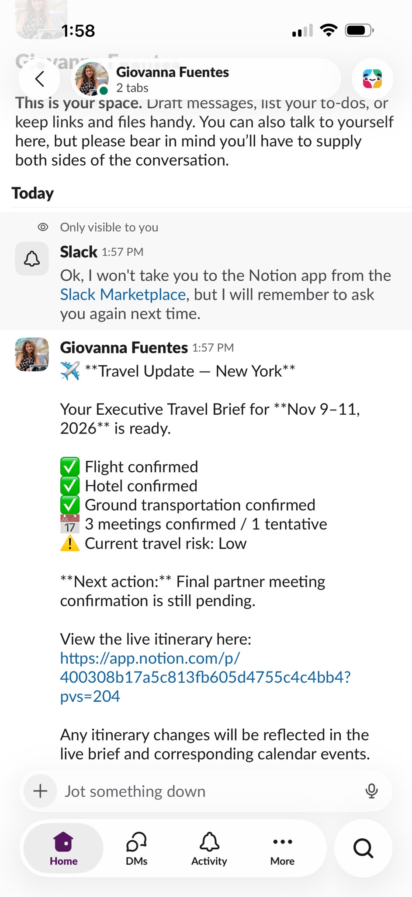

Slack is used as the immediate communication layer for concise travel updates. A useful executive update answers three questions:

1. What changed?
2. What is the impact?
3. Does the executive need to do anything?

The live itinerary remains the source of detail while Slack communicates the change.

---

## Google Calendar — Execution Layer

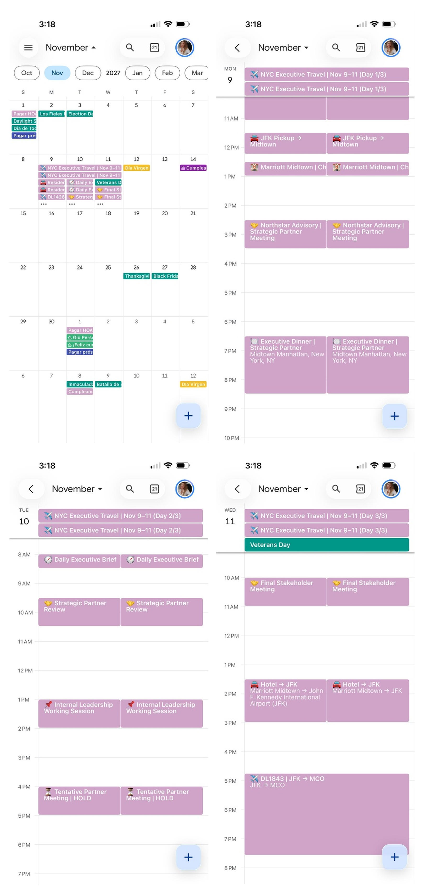

The executive calendar reflects the full travel sequence, including:

- Ground transportation
- Flights
- Hotel arrival
- Partner meetings
- Executive dinner
- Daily executive brief
- Tentative holds
- Return transportation and flight

This keeps the executive schedule aligned with the live travel brief.

---

## PDF — Offline / Printable Backup

A current PDF version of the travel brief provides continuity when internet access is unavailable or when the executive prefers a printable itinerary.

[Download the Executive Travel Brief — New York](./documents/Executive_Travel_Brief_New_York_Offline_Backup.pdf)

---

## Automation-Ready Workflow

The operating model is designed so that, with the appropriate integrations, permissions, and subscription level, systems such as **Make or Zapier** can reduce repetitive communication steps.

Example architecture:

  
  &nbsp; ➜ &nbsp;
  
  &nbsp; ➜ &nbsp;
  
  &nbsp; ➜ &nbsp;
  
  &nbsp; ➜ &nbsp;
  

**Automation layer:** Notion source of truth → Make / Zapier → Google Calendar and Slack

Possible automation scenarios include:

- Updating or creating calendar events when approved travel details change
- Sending a Slack notification when a flight, meeting, or logistics record is updated
- Creating follow-up reminders when an executive decision is captured
- Surfacing upcoming approvals or missing documentation
- Generating AI-assisted pre-brief drafts from approved source information

> The portfolio demonstrates the workflow design and executive-facing experience. Automation capability depends on the connected applications, permissions, and plans used in a production environment.

---

## Tools Used

---

## Skills Demonstrated

- Senior Executive Support
- Executive Operations
- Calendar & Meeting Management
- Executive Briefing Preparation
- Decision Tracking
- Follow-Through & Accountability
- Stakeholder Coordination
- Executive Travel Management
- Expense & Procurement Follow-Up
- Vendor / Approval Coordination
- Recurring Administrative Operations
- Risk & Escalation Management
- AI-Assisted Workflow Design
- Process Improvement
- Executive Communication

---

## Project Type

**Portfolio Project — Executive Operations & Administrative Support**

This project was created to demonstrate how modern executive support can combine operational discipline, technology, business context, and proactive follow-through to reduce friction for senior leaders.

---

**Created by Giovanna Fuentes**  
Operations & Executive Support · Business Analytics · AI & Workflow Automation
